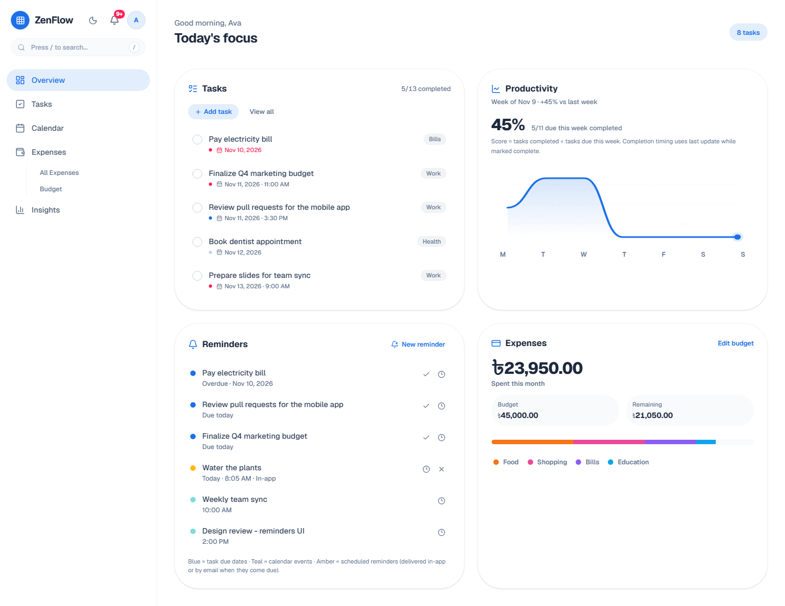
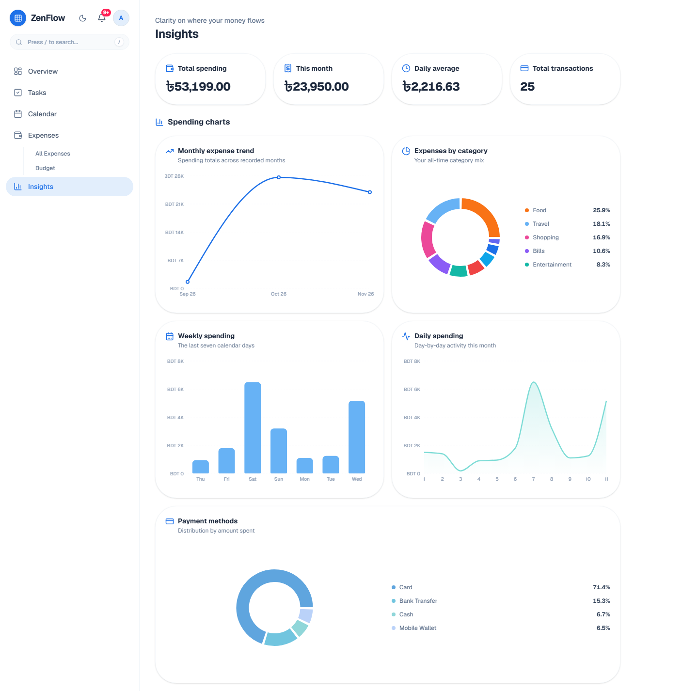
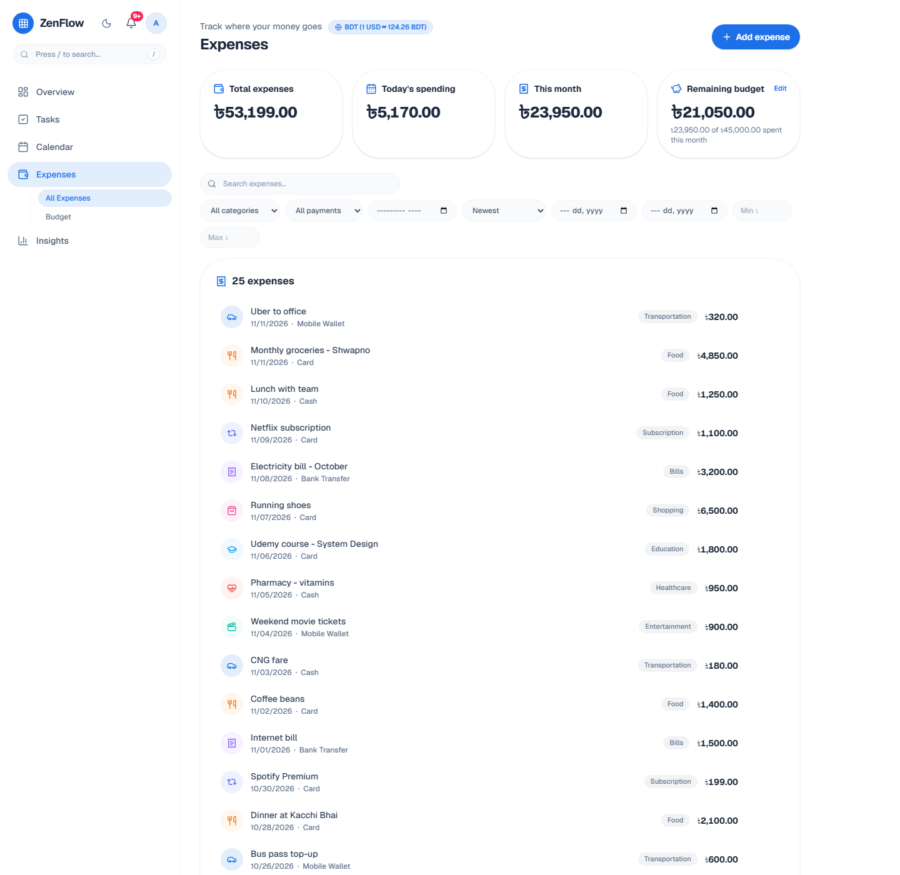
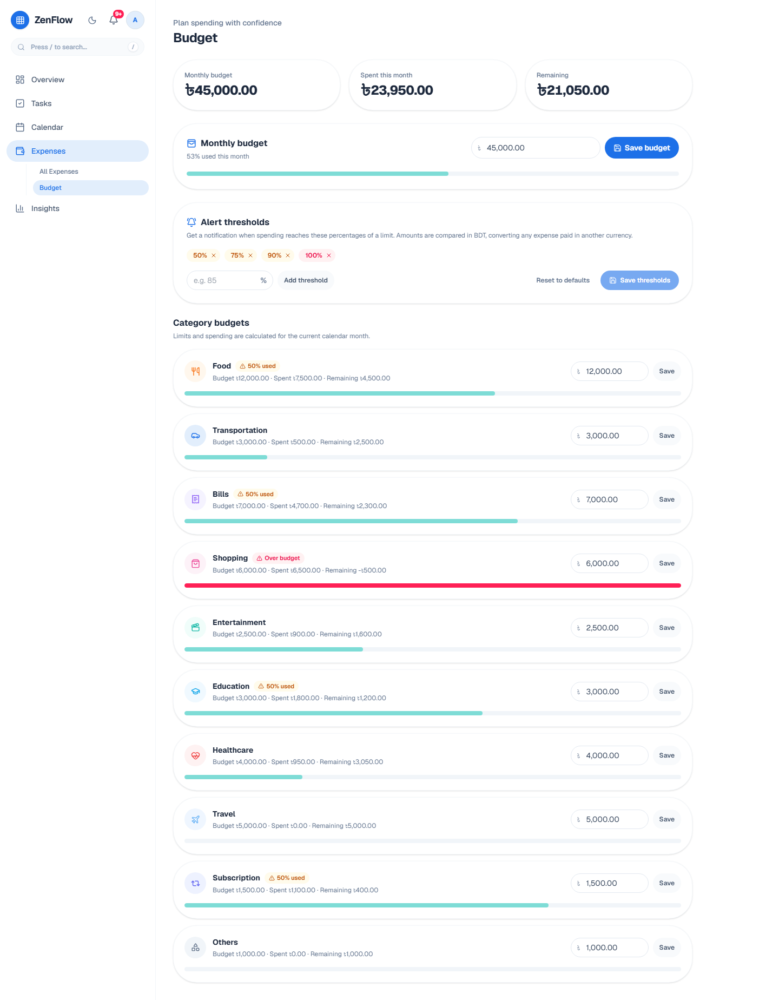
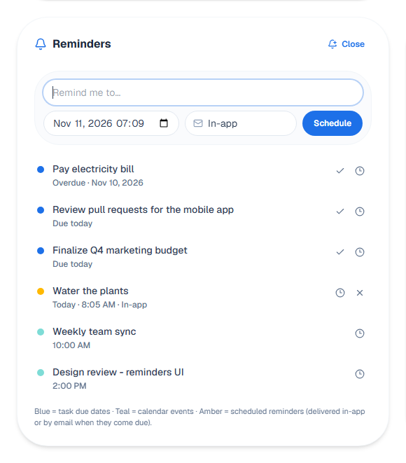
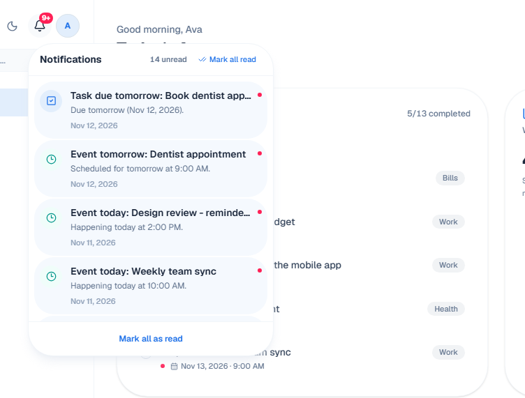
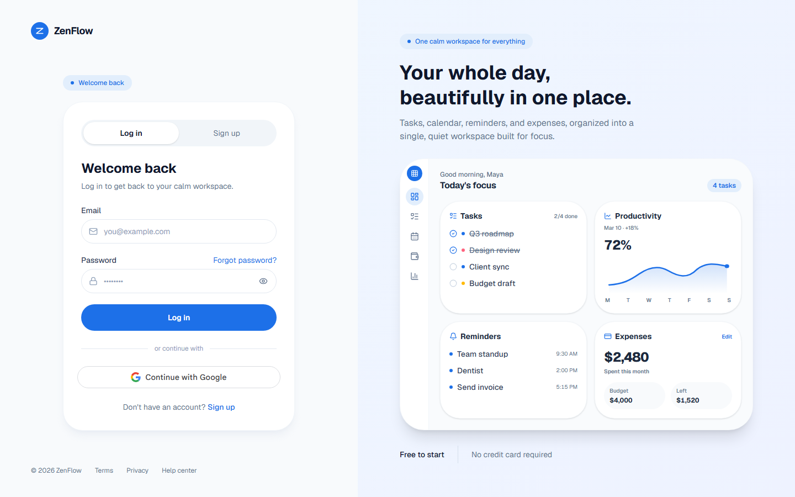

# ZenFlow Web Platform

A calm, full-stack productivity and financial workspace designed to unify task management, calendar scheduling, multi-currency expense tracking, budgets, and visual insights into a single interface.

Built with a modern Next.js App Router frontend and a Django REST Framework backend with PostgreSQL.

---

## Overview

ZenFlow helps users organize their daily workload and personal finances without switching between disconnected applications. The centralized Overview dashboard surfaces today's focus: open task queues, upcoming reminders, weekly productivity velocity, and monthly spending summaries at a glance. Dedicated sub-modules provide full task and calendar workflows, expense logging, interactive category budgets, and analytical insights.

The platform employs a decoupled full-stack architecture where the Next.js client interacts with a REST API secured by JWT authentication and Argon2 password hashing.

---

## Application Screenshots

Captured from a local development build at a 1440px desktop viewport using a seeded demo workspace (no real user data).

### Dashboard



The Overview workspace greets the user with today's focus: open tasks with due dates and categories, a weekly productivity score with a completion curve, upcoming reminders that merge task deadlines, calendar events and scheduled reminders, and a monthly spending summary against the configured budget.

### Analytics Dashboard



The Insights page aggregates expenses server-side and renders them with Recharts: monthly spending trend, all-time category mix, the last seven days of spending, a day-by-day curve for the current month, and a breakdown by payment method.

### Expense Management



Expense tracking with headline totals (all-time, today, this month, remaining budget), full-text search, and filters for category, payment method, currency, sort order, date range and amount. Each row shows the category tag, payment method and amount in the display currency.

### Budget Management



Monthly budget limit with a live usage gauge, configurable alert thresholds (50/75/90/100% by default), and per-category allocations. Each category card shows spent vs. remaining for the current calendar month and flags categories that have crossed a threshold or gone over budget.

### Reminders



The Reminders card on the Overview combines task due dates (blue), calendar events (teal) and scheduled reminders (amber) for the next seven days. The inline composer schedules a new reminder with an in-app, email, or combined delivery channel; items can be completed, snoozed by a day, or cancelled in place.

### Notifications



The notification bell merges server-side reminder notifications with alerts derived from tasks due today or tomorrow, upcoming calendar events and budget thresholds. Unread items are highlighted with a badge count and can be marked read individually or all at once.

### Login / Signup



The authentication portal offers email/password login, Google sign-in, and a password-recovery link, with a tabbed switch to the signup flow (email OTP verification). The right-hand panel previews the workspace for new visitors.

---

## Core Capabilities

### Productivity & Workflow Management
* Overview Dashboard: Instant high-level summary of open tasks, weekly completion rates, upcoming calendar events, and real-time spending.
* Advanced Task Lifecycle: Full CRUD management with priority tiers (High, Medium, Low), category tagging, optional due dates/times, and overdue indicators.
* Interactive Calendar: FullCalendar integration offering Month, Week, Day, and List views with drag-and-drop rescheduling and synchronized task deadlines.
* Spotlight Global Search: Rapid keyboard-driven search (`/`) indexing tasks, calendar events, expenses, and workspace settings.

### Personal Finance & Multi-Currency Engine
* Expense Management: Multi-currency expense entry supporting category tagging, payment method tracking, and full-text search.
* Budget Controls: Configurable monthly spending limits with category-specific allocations and real-time visual progress gauges.
* Configurable Budget Alerts: User-defined warning thresholds (e.g. 50/75/90/100%) evaluated in the display currency after converting every expense and limit, surfaced in the notification bell.
* Multi-Currency Engine: Expenses are stored in their original currency; the client converts them into the user's display currency using live exchange rates (cached locally, with built-in fallback rates) and precision-aware rounding.
* Visual Insights: Spending analytics powered by Recharts and a server-side aggregation endpoint (`/api/analytics/summary/`) that returns per-category, per-month, per-day and per-payment-method totals.

### Reminders & Notifications
* Scheduled Reminders: Create reminders with an in-app, email, or combined delivery channel; optionally link them to a task or calendar event.
* Background Dispatcher: Celery Beat (or a cron-driven management command) fires due reminders, creates in-app notifications and sends emails.
* Notification Bell: Merges server-side reminder notifications (read state persisted per user) with derived task, event and budget alerts.

### Security, Theming & Identity
* Comprehensive Authentication: Email and password registration with 6-digit email OTP verification, native Google OAuth 2.0, and SimpleJWT sessions.
* Cookie Sessions: Access and refresh tokens are issued as `httpOnly`, `Secure` cookies (never exposed to JavaScript) with CSRF double-submit protection and refresh-token rotation/blacklisting.
* Password Recovery: Public "forgot password" flow that emails a single-use, time-limited reset link and revokes all existing sessions on reset.
* Account Security: Password change workflows and account deletion safeguarded by OTP verification.
* Curated Theming: System, Light, and Dark modes with four selectable accent palettes (ZenFlow Blue, Soft Teal, Violet, Coral).

---

## Technical Architecture

```text
┌───────────────────────────────┐              REST + JWT             ┌──────────────────────────────┐
│       Next.js Frontend        │  ◄────────────────────────────────► │    Django REST Framework     │
│   (React 19 / TypeScript)     │           JSON over HTTPS           │   + PostgreSQL (Supabase)    │
└───────────────────────────────┘                                     └──────────────────────────────┘
```

* **Frontend Architecture:** Next.js App Router, Domain-driven Custom React Hooks (`use-tasks`, `use-expenses`, `use-budget`, `use-events`, `use-reminders`, `use-analytics-summary`), and centralized AuthContext for session hydration via httpOnly cookies.
* **Backend Architecture:** Django REST Framework organised as `Views -> Serializers -> Services -> Models` (dedicated service modules in `users`, `analytics` and `reminders`), with SimpleJWT (cookie transport), Argon2 password hashing, and Celery for background jobs.

---

## Project Structure

```text
ZenFlow/
├── Asset/                    # Application screenshots used in this README
│   ├── dashboard.png         # Overview workspace
│   ├── analytics.png         # Insights / spending analytics
│   ├── expenses.png          # Expense management
│   ├── budgets.png           # Budget management
│   ├── reminders.png         # Reminders card with composer
│   ├── notifications.png     # Notification bell popover
│   └── login.png             # Login / signup portal
├── frontend/                 # Next.js web application
│   ├── src/
│   │   ├── app/              # App Router pages + same-origin proxy route handlers (api/, media/)
│   │   ├── components/       # Landing, dashboard, auth, and shared UI primitives
│   │   ├── hooks/            # Domain-specific data and state management hooks
│   │   ├── lib/              # API client, authentication, currency conversion, proxy utilities
│   │   └── types/            # TypeScript schemas and data interfaces
│   ├── public/               # Static assets
│   └── .env.example          # Frontend environment template
├── backend/                  # Django REST API service
│   ├── config/               # Settings, root URLs, Celery app, health check, WSGI/ASGI
│   ├── users/                # Authentication, cookie JWT, password recovery, OTP, Google OAuth
│   ├── tasks/                # Task CRUD and deadline logic
│   ├── events/               # Calendar events and scheduling (range-filtered)
│   ├── expenses/             # Expense transactions and multi-currency models
│   ├── budget/               # Monthly and category budget limits + alert thresholds
│   ├── analytics/            # Server-side expense aggregation endpoint
│   ├── reminders/            # Reminder model, CRUD API, Celery Beat dispatcher
│   ├── Dockerfile            # Backend container image (API / worker / beat / tests)
│   ├── Procfile, build.sh    # Render process types and build script
│   ├── .env.example          # Backend environment template
│   └── requirements.txt      # Pinned Python dependencies
├── .github/workflows/        # CI: full Django test suite against PostgreSQL
├── docker-compose.yml        # Local stack: Postgres, Redis, API, Celery worker + beat
├── netlify.toml              # Frontend deployment configuration
└── README.md                 # Project documentation
```

---

## Technology Stack

### Frontend
* Framework: Next.js 16 (App Router), React 19, TypeScript
* Styling: Tailwind CSS v4, Lucide Icons
* Component Primitives: shadcn/ui components built on Base UI (`@base-ui/react`)
* Animations: Framer Motion
* Data Visualization: Recharts, FullCalendar
* Forms & Validation: React Hook Form, Zod
* Authentication: `@react-oauth/google`

### Backend & Infrastructure
* Framework: Django 6.0, Django REST Framework 3.17 (all versions pinned in `backend/requirements.txt`; Python 3.13)
* Database: PostgreSQL (via `psycopg` and `dj-database-url`)
* Authentication: `djangorestframework-simplejwt` (httpOnly cookies + token blacklist), Argon2, `google-auth` for ID-token verification
* Background Jobs: Celery 5 + Redis (Celery Beat schedules the reminder dispatcher)
* CORS & Headers: `django-cors-headers`
* Production Serving: Gunicorn, Whitenoise
* Deployment: Vercel (frontend; a `netlify.toml` is also included for Netlify), Render (backend, via `Procfile` / `build.sh`), Supabase (database); Docker image + Compose stack included

---

## Getting Started

### Prerequisites

* Node.js 20.9+ and npm (required by Next.js 16)
* Python 3.13 (the interpreter used by the Dockerfile and CI)
* PostgreSQL 14+
* Redis (optional; only needed for the Celery-based reminder scheduler)

### 1. Clone the Repository

```bash
git clone https://github.com/NavidZamanKhan/ZenFlow.git
cd ZenFlow
```

### 2. Backend Setup

```bash
cd backend
python -m venv .venv

# Activate virtual environment
# On macOS / Linux:
source .venv/bin/activate
# On Windows:
# .venv\Scripts\activate

pip install -r requirements.txt
```

Configure `backend/.env` based on `backend/.env.example`. The most important variables are:

| Variable | Purpose |
| :--- | :--- |
| `SECRET_KEY`, `DEBUG`, `ALLOWED_HOSTS` | Standard Django settings |
| `DATABASE_URL` *or* `DB_NAME` / `DB_USER` / `DB_PASSWORD` / `DB_HOST` / `DB_PORT` | PostgreSQL connection |
| `FRONTEND_URL`, `CORS_ALLOWED_ORIGINS`, `CSRF_TRUSTED_ORIGINS` | Frontend origin(s) for CORS, CSRF and password-recovery links |
| `JWT_AUTH_COOKIE_SECURE`, `JWT_AUTH_COOKIE_SAMESITE`, `JWT_AUTH_COOKIE_DOMAIN` | Session-cookie attributes (see Production Deployment) |
| `GOOGLE_CLIENT_ID` | Required for Google sign-in; must match the frontend's `NEXT_PUBLIC_GOOGLE_CLIENT_ID` |
| `EMAIL_HOST`, `EMAIL_PORT`, `EMAIL_USE_TLS`, `EMAIL_HOST_USER`, `EMAIL_HOST_PASSWORD` | SMTP for OTP, reminder and recovery emails (printed to the console when unset) |
| `CELERY_BROKER_URL`, `REDIS_URL`, `CACHE_URL` | Redis broker for Celery and shared throttle cache |
| `REMINDER_DISPATCH_INTERVAL_SECONDS`, `REMINDER_EMAIL_MAX_ATTEMPTS` | Reminder scheduler cadence and email retry limit |

Then execute migrations and start the server:

```bash
python manage.py migrate
python manage.py runserver
```

The Django API server will start on `http://localhost:8000`.

### 3. Frontend Setup

```bash
cd ../frontend
npm install
```

Configure `frontend/.env.local` based on `frontend/.env.example`:

| Variable | Purpose |
| :--- | :--- |
| `NEXT_PUBLIC_API_URL` | API base URL for browser requests (`http://localhost:8000` locally; empty or `/` in production to use the same-origin proxy) |
| `API_PROXY_TARGET` | Server-side upstream for the same-origin proxy (defaults to `http://127.0.0.1:8000` in development) |
| `NEXT_PUBLIC_GOOGLE_CLIENT_ID` | Google OAuth client ID; must equal the backend's `GOOGLE_CLIENT_ID` |

Then run the development server:

```bash
npm run dev
```

The Next.js web application will start on `http://localhost:3000`.

### 4. Reminder Scheduler (optional locally)

Reminders are dispatched by a Celery Beat task that runs every minute (`REMINDER_DISPATCH_INTERVAL_SECONDS`). With Redis running:

```bash
cd backend
celery -A config worker --loglevel=info
celery -A config beat --loglevel=info
```

Hosts without a broker can run the equivalent management command from cron instead:

```bash
python manage.py fire_due_reminders   # e.g. * * * * *
```

### 5. Docker (alternative)

```bash
docker compose up --build                     # Postgres + Redis + API + Celery worker/beat
docker compose --profile test run --rm test   # full backend test suite
```

---

## Running the Tests

```bash
cd backend
python manage.py test            # requires a PostgreSQL database (DATABASE_URL or DB_* vars)

cd ../frontend
npm test                         # unit + integration tests for the same-origin API proxy
```

The GitHub Actions workflow in `.github/workflows/backend-tests.yml` runs system checks, a migration drift check and the complete suite against a PostgreSQL service on every push/PR touching `backend/`.

---

## Production Deployment: Sessions, Cookies & Domains

Sessions are `httpOnly` cookies set by the API, so **where the API lives relative to the frontend decides whether browsers will store them at all**.

### Recommended topology: same site

Serve both apps under one registrable domain, e.g.

| Role | Host | Notes |
| :--- | :--- | :--- |
| Frontend (Next.js) | `app.example.com` | Netlify/Vercel custom domain |
| API (Django) | `api.example.com` | Render custom domain |

With this layout the cookies are first-party, so set on the API:

```env
FRONTEND_URL=https://app.example.com
CORS_ALLOWED_ORIGINS=https://app.example.com
CSRF_TRUSTED_ORIGINS=https://app.example.com
JWT_AUTH_COOKIE_SAMESITE=Lax      # same-site: no cross-site cookie needed
JWT_AUTH_COOKIE_SECURE=True
DEBUG=False
```

and on the frontend `NEXT_PUBLIC_API_URL=https://api.example.com`.

### Alternative without a custom domain: same-origin proxy

If the frontend must stay on `*.netlify.app` / `*.vercel.app` and the API on `*.onrender.com`, those are **different sites**. The API's cookies are then *third-party* cookies: Safari (ITP) and Brave drop them by default, Firefox partitions them and Chrome is phasing them out, so login appears to succeed but the next request is unauthenticated. `SameSite=None; Secure` (the default when `DEBUG=False`) is required for the browsers that still allow them, but does not help where they are blocked.

The portable fix is to route API calls through the frontend's own origin. The App Router route handlers in `frontend/src/app/api/[[...path]]/route.ts` and `frontend/src/app/media/[[...path]]/route.ts` forward `/api/*` and `/media/*` to the Django upstream and rewrite the `Set-Cookie` domain/SameSite attributes on the way back. Configure the frontend with

```env
API_PROXY_TARGET=https://zenflow-xxxx.onrender.com   # server side; BACKEND_API_URL is accepted as an alias
NEXT_PUBLIC_API_URL=/                                 # "/" (or empty) = same origin
```

and every browser request is proxied by Next.js (works on Vercel and on Netlify's Next runtime), so cookies are first-party and the API can use `JWT_AUTH_COOKIE_SAMESITE=Lax`. `FRONTEND_URL` / `CSRF_TRUSTED_ORIGINS` / `CORS_ALLOWED_ORIGINS` must still name the frontend origin exactly; never use wildcard origins with credentialed requests, and do not add Netlify deploy-preview hosts (`deploy-preview-*--site.netlify.app`) to the trusted lists - previews should use their own API instance or stay logged-out.

### Operational checklist

* `GOOGLE_CLIENT_ID` **must** be set; Google sign-in refuses to run without it (the token audience cannot be verified otherwise). Only Google **ID tokens** are accepted by `POST /api/auth/google/`.
* `DEBUG=False` in production. In `DEBUG=True` the password-reset link (which embeds the token) is printed to the console for local development.
* Set `FRONTEND_URL=https://zenflowbd.vercel.app` in Render environment variables so password recovery emails point directly to the production frontend (also defaults safely to `https://zenflowbd.vercel.app` when `DEBUG=False`).
* Set `CACHE_URL` (or reuse `REDIS_URL`) so DRF throttle counters are shared across gunicorn workers; without it each worker keeps its own in-memory counters.
* Run `python manage.py flushexpiredtokens` periodically (e.g. daily cron / Render cron job) to prune expired entries from the SimpleJWT outstanding/blacklist tables; nothing else deletes them.
* Optional: `JWT_CHECK_REVOKE_TOKEN=True` makes *access* tokens stop working the moment a password changes (not just refresh tokens). Tokens issued before the switch carry no digest and are rejected, so enabling it signs every active user out once.

---

## API Route Summary

Authentication uses `httpOnly` JWT cookies set by the login/verify/Google endpoints. Browsers must send credentials (`credentials: 'include'`) and include the `X-CSRFToken` header (returned as `csrfToken` by the auth endpoints or `GET /api/auth/csrf/`) on mutating requests. An `Authorization: Bearer <access_token>` header is still accepted for non-browser clients.

| Endpoint Prefix | Description |
| :--- | :--- |
| `/api/health/` | Liveness/readiness probe (database connectivity) |
| `/api/auth/` | Registration, OTP verification/resend, login, Google OAuth, cookie refresh/logout, CSRF token, profile (`me/`), OTP-verified password change and account deletion |
| `/api/auth/password/forgot/` | Public password recovery: request link, validate token, confirm new password |
| `/api/tasks/` | Task CRUD operations with priority tags and deadline timestamps |
| `/api/events/` | Calendar event management; supports `?start=&end=` range filters (used by every frontend view) |
| `/api/expenses/` | Expense transaction CRUD; amounts are stored with their original currency (conversion happens client-side) |
| `/api/budget/` | Monthly budget limits, category allocations and `warningThresholds` |
| `/api/analytics/summary/` | Aggregated expense totals per category / month / day / payment method (optional `?start=&end=`) |
| `/api/reminders/` | Reminder CRUD, `POST {id}/snooze/`, and `notifications/` (list, `read`, `read-all`) |

---

## Ecosystem Repositories

* Web Application (Full-Stack): [ZenFlow](https://github.com/NavidZamanKhan/ZenFlow)
* Mobile Application (iOS & Android): [ZenFlow-Flutter](https://github.com/NavidZamanKhan/ZenFlow-Flutter)

---

## License

Private and proprietary. All rights reserved.
