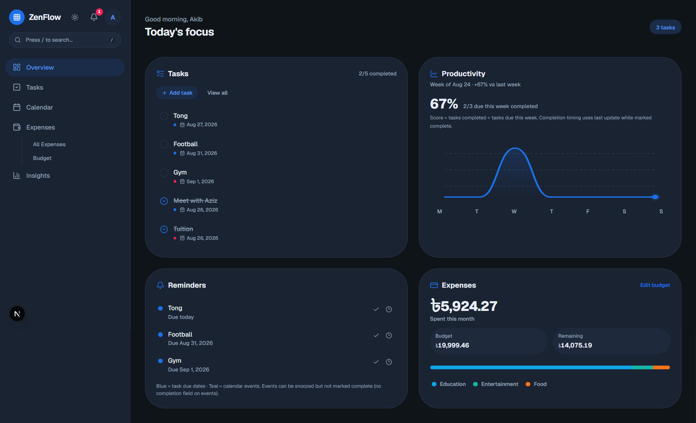
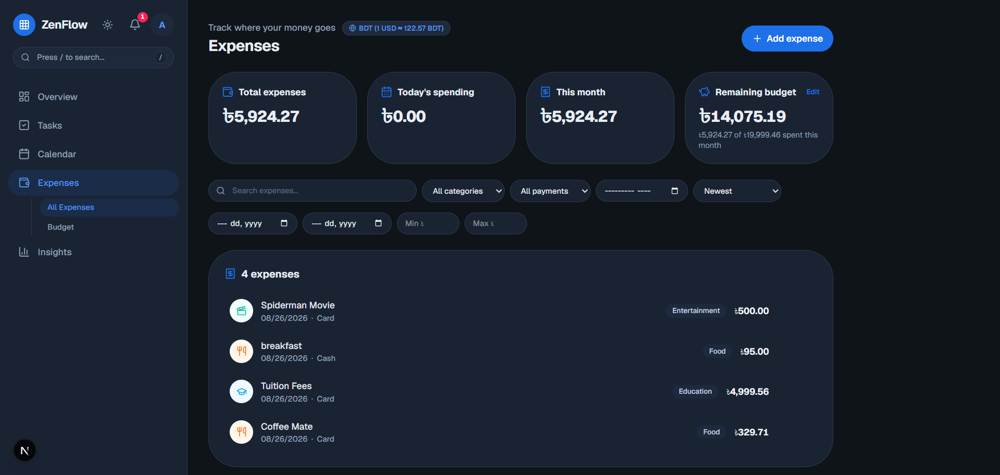
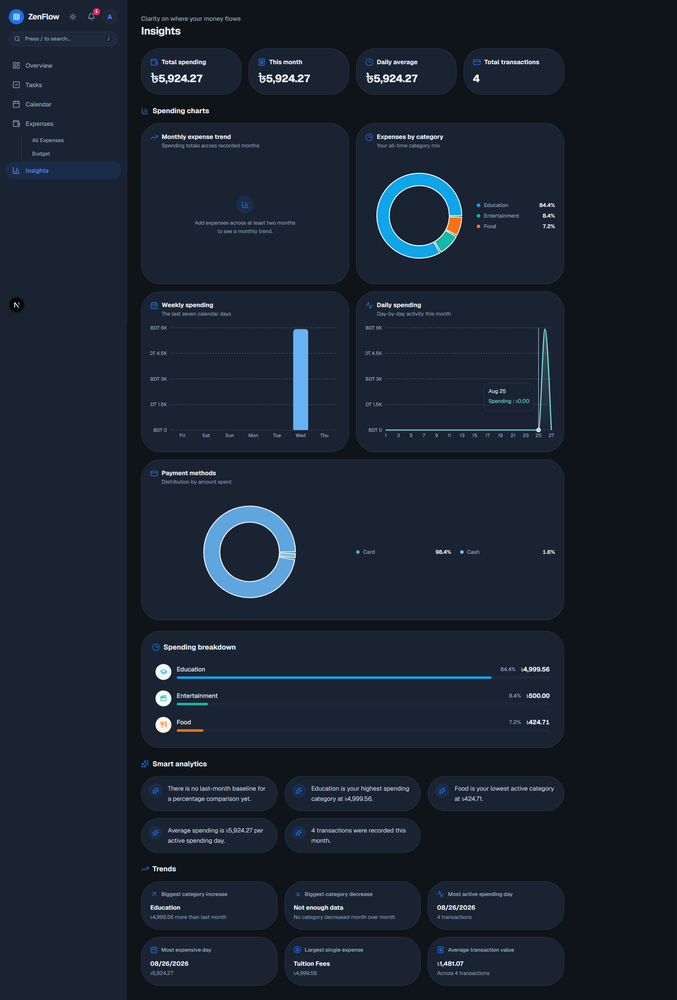

# ZenFlow Web Platform

A calm, full-stack productivity and financial workspace designed to unify task management, calendar scheduling, multi-currency expense tracking, budgets, and visual insights into a single interface.

Built with a modern Next.js App Router frontend and a Django REST Framework backend with PostgreSQL.

---

## Overview

ZenFlow helps users organize their daily workload and personal finances without switching between disconnected applications. The centralized Overview dashboard surfaces today's focus: open task queues, upcoming reminders, weekly productivity velocity, and monthly spending summaries at a glance. Dedicated sub-modules provide full task and calendar workflows, expense logging, interactive category budgets, and analytical insights.

The platform employs a decoupled full-stack architecture where the Next.js client interacts with a REST API secured by JWT authentication and Argon2 password hashing.

---

## User Interface Showcase

### 1. Public Portal & Workspace Overview

<table>
  <thead>
    <tr>
      <th width="50%" align="center">Landing Page & Public Portal</th>
      <th width="50%" align="center">Central Overview Dashboard</th>
    </tr>
  </thead>
  <tbody>
    <tr>
      <td align="center" valign="top">
        
      </td>
      <td align="center" valign="top">
        
      </td>
    </tr>
    <tr>
      <td align="center" valign="top">Public marketing interface showcasing platform capabilities, workflow highlights, security standards, and authentication entry points.</td>
      <td align="center" valign="top">Personalized workspace displaying today's tasks, weekly productivity velocity curves, scheduled reminders, and monthly financial summaries.</td>
    </tr>
  </tbody>
</table>

---

### 2. Financial Management & Analytics

<table>
  <thead>
    <tr>
      <th width="50%" align="center">Expense Tracking & Budgeting</th>
      <th width="50%" align="center">Spending Analytics & Visualizations</th>
    </tr>
  </thead>
  <tbody>
    <tr>
      <td align="center" valign="top">
        
      </td>
      <td align="center" valign="top">
        
      </td>
    </tr>
    <tr>
      <td align="center" valign="top">Multi-currency financial logging with category filters, payment method tagging, search, and interactive monthly budget gauges.</td>
      <td align="center" valign="top">Analytical intelligence suite featuring category distribution donut charts, daily spending wave curves, and transaction volume trends.</td>
    </tr>
  </tbody>
</table>

---

## Core Capabilities

### Productivity & Workflow Management
* Overview Dashboard: Instant high-level summary of open tasks, weekly completion rates, upcoming calendar events, and real-time spending.
* Advanced Task Lifecycle: Full CRUD management with priority tiers (High, Medium, Low), category tagging, optional due dates/times, and overdue indicators.
* Interactive Calendar: FullCalendar integration offering Month, Week, Day, and List views with drag-and-drop rescheduling and synchronized task deadlines.
* Spotlight Global Search: Rapid keyboard-driven search (`/`) indexing tasks, calendar events, expenses, and workspace settings.

### Personal Finance & Multi-Currency Engine
* Expense Management: Multi-currency expense entry supporting category tagging, payment method tracking, and full-text search.
* Budget Controls: Configurable monthly spending limits with category-specific allocations and real-time visual progress gauges.
* Multi-Currency Engine: Display currency configuration with automatic conversion and precision rounding heuristics.
* Visual Insights: Spending analytics powered by Recharts, including category donut distributions, payment method breakdowns, and daily spending wave charts.

### Reminders & Notifications
* Scheduled Reminders: Create reminders with an in-app, email, or combined delivery channel; optionally link them to a task or calendar event.
* Background Dispatcher: Celery Beat (or a cron-driven management command) fires due reminders, creates in-app notifications and sends emails.
* Notification Bell: Merges server-side reminder notifications (read state persisted per user) with derived task, event and budget alerts.

### Security, Theming & Identity
* Comprehensive Authentication: Email and password registration with 6-digit email OTP verification, native Google OAuth 2.0, and SimpleJWT sessions.
* Cookie Sessions: Access and refresh tokens are issued as `httpOnly`, `Secure` cookies (never exposed to JavaScript) with CSRF double-submit protection and refresh-token rotation/blacklisting.
* Password Recovery: Public "forgot password" flow that emails a single-use, time-limited reset link and revokes all existing sessions on reset.
* Account Security: Password change workflows and account deletion safeguarded by OTP verification.
* Curated Theming: System, Light, and Dark modes with four selectable accent palettes (ZenFlow Blue, Soft Teal, Violet, Coral).

---

## Technical Architecture

```text
┌───────────────────────────────┐              REST + JWT             ┌──────────────────────────────┐
│       Next.js Frontend        │  ◄────────────────────────────────► │    Django REST Framework     │
│   (React 19 / TypeScript)     │           JSON over HTTPS           │   + PostgreSQL (Supabase)    │
└───────────────────────────────┘                                     └──────────────────────────────┘
```

* **Frontend Architecture:** Next.js App Router, Domain-driven Custom React Hooks (`use-tasks`, `use-expenses`, `use-budget`, `use-events`, `use-reminders`), and centralized AuthContext for session hydration.
* **Backend Architecture:** Django REST Framework with strict layered separation: `Views -> Serializers -> Services -> Models` with SimpleJWT, Argon2 password hashing, and Celery for background jobs.

---

## Project Structure

```text
ZenFlow/
├── Screenshots/              # Product screenshots for documentation
│   ├── Landing Page.png      # Marketing portal screenshot
│   ├── Dashboard.png         # Overview workspace screenshot
│   ├── Expense.png           # Multi-currency expense screenshot
│   └── Insights.png          # Visual analytics screenshot
├── frontend/                 # Next.js web application
│   └── src/
│       ├── app/              # App Router pages and route handlers
│       ├── components/       # Landing, dashboard, auth, and shared UI primitives
│       ├── hooks/            # Domain-specific data and state management hooks
│       ├── lib/              # API client, authentication, currency conversion
│       └── types/            # TypeScript schemas and data interfaces
├── backend/                  # Django REST API service
│   ├── config/               # Settings, root URLs, Celery app, and WSGI/ASGI configuration
│   ├── users/                # Authentication, user profile, OTP, and Google OAuth
│   ├── tasks/                # Task CRUD and deadline logic
│   ├── events/               # Calendar events and scheduling
│   ├── expenses/             # Expense transactions and multi-currency models
│   ├── budget/               # Monthly and category budget limit models
│   └── reminders/            # Reminder model, CRUD API, Celery Beat dispatcher
├── netlify.toml              # Frontend deployment configuration
└── README.md                 # Project documentation
```

---

## Technology Stack

### Frontend
* Framework: Next.js 16 (App Router), React 19, TypeScript
* Styling: Tailwind CSS v4, Lucide Icons
* Component Primitives: Radix UI / shadcn/ui
* Animations: Framer Motion
* Data Visualization: Recharts, FullCalendar
* Forms & Validation: React Hook Form, Zod
* Authentication: `@react-oauth/google`

### Backend & Infrastructure
* Framework: Django 6.0, Django REST Framework
* Database: PostgreSQL (via `psycopg` and `dj-database-url`)
* Authentication: `djangorestframework-simplejwt`, Argon2
* Background Jobs: Celery 5 + Redis (Celery Beat schedules the reminder dispatcher)
* CORS & Headers: `django-cors-headers`
* Production Serving: Gunicorn, Whitenoise
* Deployment: Netlify (Frontend), Render (Backend), Supabase (Database)

---

## Getting Started

### Prerequisites

* Node.js 18+ and npm
* Python 3.12+
* PostgreSQL 14+

### 1. Clone the Repository

```bash
git clone https://github.com/NavidZamanKhan/ZenFlow.git
cd ZenFlow
```

### 2. Backend Setup

```bash
cd backend
python -m venv .venv

# Activate virtual environment
# On macOS / Linux:
source .venv/bin/activate
# On Windows:
# .venv\Scripts\activate

pip install -r requirements.txt
```

Configure `backend/.env` based on `backend/.env.example`, then execute migrations:

```bash
python manage.py migrate
python manage.py runserver
```

The Django API server will start on `http://localhost:8000`.

### 3. Frontend Setup

```bash
cd ../frontend
npm install
```

Configure `frontend/.env.local` based on `frontend/.env.example`, then run the development server:

```bash
npm run dev
```

The Next.js web application will start on `http://localhost:3000`.

### 4. Reminder Scheduler (optional locally)

Reminders are dispatched by a Celery Beat task that runs every minute (`REMINDER_DISPATCH_INTERVAL_SECONDS`). With Redis running:

```bash
cd backend
celery -A config worker --loglevel=info
celery -A config beat --loglevel=info
```

Hosts without a broker can run the equivalent management command from cron instead:

```bash
python manage.py fire_due_reminders   # e.g. * * * * *
```

---

## Production Deployment: Sessions, Cookies & Domains

Sessions are `httpOnly` cookies set by the API, so **where the API lives relative to the frontend decides whether browsers will store them at all**.

### Recommended topology: same site

Serve both apps under one registrable domain, e.g.

| Role | Host | Notes |
| :--- | :--- | :--- |
| Frontend (Next.js) | `app.example.com` | Netlify/Vercel custom domain |
| API (Django) | `api.example.com` | Render custom domain |

With this layout the cookies are first-party, so set on the API:

```env
FRONTEND_URL=https://app.example.com
CORS_ALLOWED_ORIGINS=https://app.example.com
CSRF_TRUSTED_ORIGINS=https://app.example.com
JWT_AUTH_COOKIE_SAMESITE=Lax      # same-site: no cross-site cookie needed
JWT_AUTH_COOKIE_SECURE=True
DEBUG=False
```

and on the frontend `NEXT_PUBLIC_API_URL=https://api.example.com`.

### Alternative without a custom domain: same-origin proxy

If the frontend must stay on `*.netlify.app` / `*.vercel.app` and the API on `*.onrender.com`, those are **different sites**. The API's cookies are then *third-party* cookies: Safari (ITP) and Brave drop them by default, Firefox partitions them and Chrome is phasing them out, so login appears to succeed but the next request is unauthenticated. `SameSite=None; Secure` (the default when `DEBUG=False`) is required for the browsers that still allow them, but does not help where they are blocked.

The portable fix is to route API calls through the frontend's own origin. `frontend/next.config.ts` adds an opt-in rewrite: build the frontend with

```env
API_PROXY_TARGET=https://zenflow-xxxx.onrender.com   # build-time, server side
NEXT_PUBLIC_API_URL=/                                 # "/" = same origin
```

and every `/api/*` request is proxied by Next.js (supported by Netlify's Next runtime and by Vercel), so cookies are first-party and the API can use `JWT_AUTH_COOKIE_SAMESITE=Lax`. `FRONTEND_URL` / `CSRF_TRUSTED_ORIGINS` / `CORS_ALLOWED_ORIGINS` must still name the frontend origin exactly; never use wildcard origins with credentialed requests, and do not add Netlify deploy-preview hosts (`deploy-preview-*--site.netlify.app`) to the trusted lists - previews should use their own API instance or stay logged-out.

### Operational checklist

* `GOOGLE_CLIENT_ID` **must** be set; Google sign-in refuses to run without it (the token audience cannot be verified otherwise). Only Google **ID tokens** are accepted by `POST /api/auth/google/`.
* `DEBUG=False` in production. In `DEBUG=True` the password-reset link (which embeds the token) is printed to the console for local development.
* Set `CACHE_URL` (or reuse `REDIS_URL`) so DRF throttle counters are shared across gunicorn workers; without it each worker keeps its own in-memory counters.
* Run `python manage.py flushexpiredtokens` periodically (e.g. daily cron / Render cron job) to prune expired entries from the SimpleJWT outstanding/blacklist tables; nothing else deletes them.
* Optional: `JWT_CHECK_REVOKE_TOKEN=True` makes *access* tokens stop working the moment a password changes (not just refresh tokens). Tokens issued before the switch carry no digest and are rejected, so enabling it signs every active user out once.

---

## API Route Summary

All authenticated endpoints require an `Authorization: Bearer <access_token>` header.

| Endpoint Prefix | Description |
| :--- | :--- |
| `/api/auth/` | Registration, OTP verification/resend, login, Google OAuth, profile, and account deletion |
| `/api/tasks/` | Task CRUD operations with priority tags and deadline timestamps |
| `/api/events/` | Calendar event management and schedule queries |
| `/api/expenses/` | Expense transaction logging, filtering, and currency conversion |
| `/api/budget/` | Monthly budget limits and category allocation endpoints |
| `/api/reminders/` | Reminder CRUD, `POST {id}/snooze/`, and `notifications/` (list, `read`, `read-all`) |

---

## Ecosystem Repositories

* Web Application (Full-Stack): [ZenFlow](https://github.com/NavidZamanKhan/ZenFlow)
* Mobile Application (iOS & Android): [ZenFlow-Flutter](https://github.com/NavidZamanKhan/ZenFlow-Flutter)

---

## License

Private and proprietary. All rights reserved.
